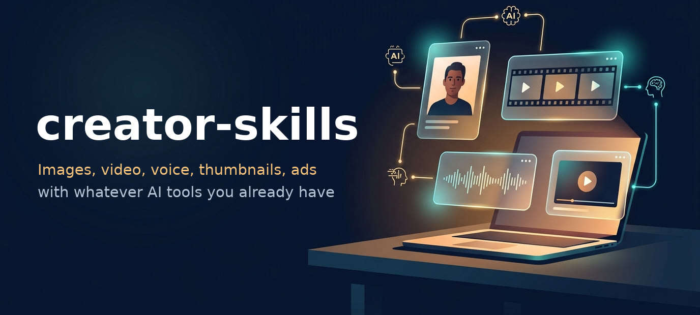
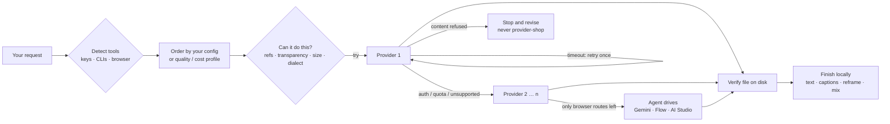
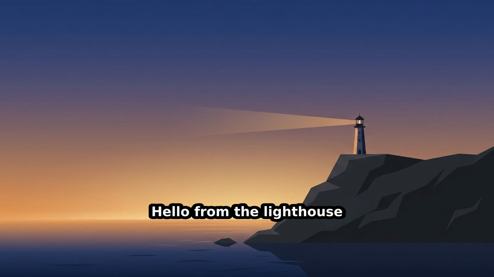

<p align="center">
  
</p>

<p align="center">
  <a href="https://skills.sh/mehbylabs/creator-skills"></a>
  <a href="https://github.com/mehbylabs/creator-skills/actions/workflows/validate.yml"></a>
  <a href="LICENSE"></a>
  
  
</p>

<p align="center">
  <b>Agent skills for creators that work with the tools you already have —<br>
  and keep working when one of them doesn't.</b>
</p>

---

Most AI media skills are built around one vendor. If you don't have that account, or its
credits run out, or it's down, you're stuck.

**creator-skills** detects what *you* have — a CLI, an API key, a ChatGPT or Google
subscription, or just a browser — picks the best route for each job, and falls back
automatically when a route fails. Your agent (Claude Code, OpenCode, Codex, Antigravity,
Cursor…) does the thinking; the providers do the rendering; local ffmpeg does the finishing.

```bash
npx skills add mehbylabs/creator-skills
```

Then just ask your agent:

> *"Make a YouTube thumbnail for my video about learning to navigate without GPS."*<br>
> *"Turn this article into a 60-second vertical explainer with voiceover and captions."*<br>
> *"اعمل تعليق صوتي بالمصري للإعلان ده"* — Egyptian Arabic voiceover for this ad<br>
> *"Product photos of this bottle for my Amazon listing."*

## Contents

- [Skills](#skills)
- [Providers](#providers)
- [How routing works](#how-routing-works)
- [Arabic and dialect voiceovers](#arabic-and-dialect-voiceovers)
- [Connect your tools](#connect-your-tools)
- [Examples](#examples)
- [Configuration](#configuration)
- [Use from the command line](#use-from-the-command-line)
- [FAQ](#faq)
- [Contributing](#contributing)

## Skills

| Skill | What you get | Try asking |
|---|---|---|
| [`creator-setup`](skills/creator-setup/SKILL.md) | Detects your tools, connects keys and logins, sets priorities | "set up creator skills" |
| [`creator-image`](skills/creator-image/SKILL.md) | Images, edits with references, transparent PNGs | "a flat vector hero image of a lighthouse, 16:9" |
| [`creator-video`](skills/creator-video/SKILL.md) | Text/image-to-video, first+last frame, reframe, captions | "animate this photo with a slow push-in" |
| [`creator-audio`](skills/creator-audio/SKILL.md) | Voiceovers (incl. Arabic dialects), music beds, sound effects | "a calm lo-fi bed, 60 seconds, instrumental" |
| [`creator-thumbnail`](skills/creator-thumbnail/SKILL.md) | YouTube thumbnails & vertical covers, 2–3 variants, crisp headlines | "thumbnail for my GPS video, use my face" |
| [`creator-product-photo`](skills/creator-product-photo/SKILL.md) | Studio, lifestyle, Pinterest, hero, try-on, marketplace sets | "Amazon main + 5 secondary images" |
| [`creator-ad`](skills/creator-ad/SKILL.md) | 15–30 s UGC-style ads, hook variants, 9:16 / 1:1 / 16:9 | "3 TikTok ad variants for my app" |
| [`creator-explainer`](skills/creator-explainer/SKILL.md) | Topic → script → voice → visuals → captioned MP4 | "explain compound interest in 60 s" |
| [`creator-character`](skills/creator-character/SKILL.md) | Same face or mascot across images and video | "make a mascot and keep it consistent" |
| [`creator-brandkit`](skills/creator-brandkit/SKILL.md) | Palette, type, SVG logos, mockups, reusable `brand.json` | "brand kit for my coffee channel" |

Install a single skill: `npx skills add mehbylabs/creator-skills --skill creator-thumbnail`

## Providers

| Provider | Image | Video | Voice | Music | SFX | You need |
|---|:-:|:-:|:-:|:-:|:-:|---|
| **Higgsfield CLI** | ✅ | ✅ Seedance · Kling · Veo | | ✅ | ✅ | Higgsfield account |
| **Google Gemini API** | ✅ Nano Banana | ✅ Gemini Omni | ✅ incl. Arabic | ✅ Lyria | | `GEMINI_API_KEY` |
| **OpenAI API** | ✅ gpt-image · transparent | | ✅ ¹ | | | `OPENAI_API_KEY` |
| **ElevenLabs** | | | ✅ | ✅ | ✅ | `ELEVENLABS_API_KEY` |
| **Google Cloud TTS** | | | ✅ `ar-EG` + accent prompt | | | `gcloud` login |
| **Azure Speech** | | | ✅ 16 Arabic country voices | | | key + region |
| **Antigravity CLI** (`agy`) | ✅ | | | | | Google sign-in |
| **Codex CLI** | ✅ | | | | | ChatGPT sign-in |
| **Gemini web app** | ✅ | ✅ | | | | browser + computer use |
| **Google Flow** | ✅ | ✅ Veo | | | | browser + computer use |
| **Google AI Studio** | | | ✅ voice design | | | browser + computer use |
| **ffmpeg** (local) | text, cutouts, reframe | Ken Burns, captions, assembly | mixing | ducking | | always |

¹ OpenAI's speech models retire January 2027; they're last in the voice order.

You don't need all of these. **One** is enough to start — `agy` alone (just a Google
sign-in) covers images, and with ffmpeg that also gives you animated-still video.

## How routing works



Default orders (you can override any of them):

| Task | `quality` (default) | `cost` (subscriptions first) |
|---|---|---|
| Image | Higgsfield → Gemini API → OpenAI → agy → Codex → Gemini web → Flow | agy → Codex → Higgsfield → Gemini API → OpenAI → Gemini web → Flow |
| Video | Higgsfield → Gemini API → Flow → Gemini web | Flow → Gemini web → Higgsfield → Gemini API |
| Voice | ElevenLabs → Gemini API → Cloud TTS → Azure → OpenAI → AI Studio | Gemini API → AI Studio → Cloud TTS → Azure → ElevenLabs → OpenAI |
| Voice, Arabic | Gemini API → Cloud TTS → Azure → ElevenLabs → OpenAI → AI Studio | same |

**When nothing can generate**, the skills degrade instead of failing: no video provider →
animated stills; no good text rendering → art + local typography; no transparency →
white background + local cutout.

Full rules: [`providers.md`](shared/references/providers.md)

## Arabic and dialect voiceovers

Pass `--lang` (or just tell the agent the dialect) and voiceovers route to the providers
that handle it best, with accent direction and per-country voices:

| `--lang` | Dialect | Best route |
|---|---|---|
| `ar` | Fusha / MSA | Gemini TTS |
| `ar-EG` | Egyptian | Gemini TTS (officially supported), Cloud TTS `ar-EG` |
| `ar-SA` `ar-AE` `ar-KW` `ar-QA` | Saudi / Gulf | Gemini TTS (prompted), Azure country voices |
| `ar-LB` `ar-SY` `ar-JO` `ar-PS` | Levantine | Gemini TTS (prompted), Azure |
| `ar-IQ` | Iraqi | Gemini TTS (prompted), Azure |
| `ar-MA` `ar-DZ` `ar-TN` | Maghrebi / Darija | Azure, Gemini TTS (test first) |

The skill writes (or converts) your script **in the dialect's own spelling** — the biggest
factor in sounding native — and has you approve the first line before generating the rest.
Guide: [`arabic-voice.md`](shared/references/arabic-voice.md)

## Connect your tools

Keys are typed into a **hidden prompt in your own terminal**, verified with a free API call,
and stored in `~/.config/creator-skills/.env` (mode 600, loaded automatically). Logins run
each tool's own OAuth.

```bash
S=~/.claude/skills/creator-setup/scripts   # wherever your agent installed the skills

python3 $S/connect.py verify               # what's connected (keys masked)
python3 $S/connect.py google-api           # paste key → verified → saved
python3 $S/connect.py higgsfield           # install + browser login
python3 $S/connect.py aistudio-browser     # enable a browser app
op read "op://Private/ElevenLabs/key" | python3 $S/connect.py elevenlabs --stdin
```

Or ask your agent to *"set up creator skills"* — it checks everything and tells you the exact
command to run. Agents are instructed **never** to ask for keys in chat or read `.env` files.
Guide: [`connect.md`](shared/references/connect.md)

## Examples

Made with this repo on a machine that only had **`agy` + ffmpeg** — no API keys.

<table>
  <tr>
    <td width="50%"></td>
    <td width="50%"></td>
  </tr>
  <tr>
    <td align="center"><sub><b>creator-thumbnail</b>, step 1 — art generated with empty space for the headline (<code>agy</code>, 60 s)</sub></td>
    <td align="center"><sub>step 2 — headline added locally, so it's always crisp and spelled right</sub></td>
  </tr>
  <tr>
    <td></td>
    <td></td>
  </tr>
  <tr>
    <td align="center"><sub><b>creator-image</b> — "flat vector lighthouse at dusk, indigo and amber", 16:9</sub></td>
    <td align="center"><sub><b>creator-video</b> fallback — still → Ken Burns clip → burned captions</sub></td>
  </tr>
</table>

<p align="center">
  <br>
  <sub><code>media.py reframe --ratio 9:16 --mode blur</code> — a 16:9 clip ready for Shorts/Reels</sub>
</p>

## Configuration

Optional. Without a config everything auto-detects and uses the `quality` profile.
`~/.config/creator-skills/config.json`:

```json
{
  "profile": "cost",
  "order": { "speech:ar-MA": ["azure-tts", "google-api"] },
  "disabled": ["openai-api"],
  "voices": { "google-api:ar-EG": "Charon", "azure-tts:ar-SA": "ar-SA-HamedNeural" },
  "browser": { "enabled": true, "apps": ["gemini", "flow", "aistudio"] },
  "brand": { "colors": ["#0B1F3A", "#FF6B35"], "fonts": { "heading": "/path/Heading.ttf" } }
}
```

Reference: [`config.md`](shared/references/config.md)

## Use from the command line

The skills are thin instructions around two stdlib-only Python scripts you can run directly:

```bash
S=skills/creator-image/scripts

python3 $S/creator.py detect                                   # what's available
python3 $S/creator.py plan --task speech --lang ar-EG          # route that would be used
python3 $S/creator.py image  --prompt "…" --ratio 16:9 --out out/hero.png
python3 $S/creator.py video  --prompt "slow push-in" --start out/hero.png --out out/clip.mp4
python3 $S/creator.py speech --text-file vo.txt --lang ar-EG --out out/vo.mp3
python3 $S/creator.py music  --prompt "lo-fi, 80 bpm" --instrumental --duration 60 --out out/bed.mp3

python3 $S/media.py text     --image out/hero.png --text "BIG\nIDEA" --align left --out out/thumb.png
python3 $S/media.py still    --image out/hero.png --duration 6 --out out/still.mp4
python3 $S/media.py assemble --scenes scenes.json --music out/bed.mp3 --out out/final.mp4
```

Every command prints JSON: `ok`, `needs_browser` (with the request to reproduce in the
browser), `blocked` (content refused — no provider-shopping), or `failed` (with the exact
`connect` command that would fix it).

## FAQ

**Do I need all these accounts?** No. One provider is enough to start; add more for better
quality or resilience.

**Which agents does it work with?** Anything that loads Agent Skills: Claude Code, OpenCode,
Codex, Cursor, Antigravity, Gemini CLI, GitHub Copilot, Windsurf, and more via `npx skills`.

**How does browser fallback work?** If your agent has a browser / computer-use tool and you
enable it, the skills include step-by-step playbooks for the Gemini app, Google Flow, and
AI Studio. You sign in once yourself; the agent never types passwords.

**Is it safe with my keys?** Keys never pass through chat or command lines, are stored with
user-only permissions, and are masked in every output. See [`connect.md`](shared/references/connect.md).

**Will it generate anything I ask?** No. If a provider refuses content, the chain stops — it
won't retry the same request elsewhere. Character and voice skills require consent for real
people.

**What's tested?** CI validates every skill against the Agent Skills spec and smoke-tests the
scripts. The `agy` and ffmpeg paths are tested end to end; API adapters are built on current
docs — please [open an issue](https://github.com/mehbylabs/creator-skills/issues) if one misbehaves.

## Contributing

```
shared/          ← edit here: creator.py, media.py, connect.py, references
skills/<name>/   ← SKILL.md + synced copies of shared/
scripts/         ← sync-shared.sh, validate.py
```

Edit `shared/`, run `scripts/sync-shared.sh`, then `python3 scripts/validate.py`.
Adding a provider or skill: see [AGENTS.md](AGENTS.md).

## Credits

Structure and conventions inspired by [higgsfield-ai/skills](https://github.com/higgsfield-ai/skills) (MIT).

## License

[MIT](LICENSE) © Mohamed Elhedi Ben Yedder
